This page walks through one automation from the first sentence to the first run. The example finds customers who stopped ordering, adds them to a Klaviyo list and posts the count in Microsoft Teams.

## Before you start

- Select the store profile you want the automation for, at the top of the page.
- Know three things: **what** should happen, **when** it should happen, and **where** the result should go (an email, a Slack channel, a list in another app).
- If the automation needs an app that is not connected yet, you can connect it on the way. Only a workspace admin can connect apps.

## Step 1: Open the builder

On the **Automations** page, select **Create with Ask Viq**. You can also type your request in the **Build something new** box on the **Overview** tab and select **Build**.

The builder has two halves:

- **On the left, your steps.** Each step appears here as a card while Ask Viq designs and tests it.
- **On the right, the Ask Viq chat.** You talk to Ask Viq here, before and after the automation is built.

<Frame>
  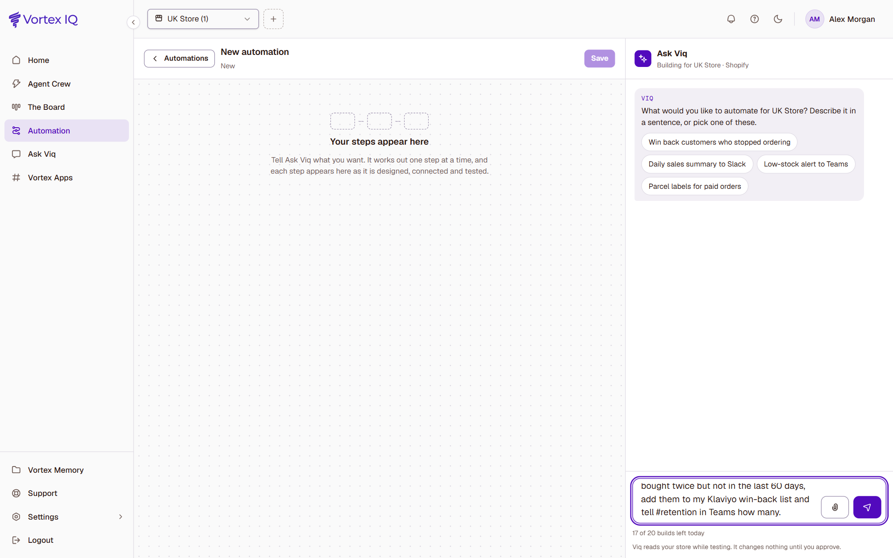
</Frame>

## Step 2: Describe what you want

Type your request in the message box and press **Enter**. To start a new line, press **Shift** and **Enter**.

Write it the way you would ask a colleague. One or two sentences are enough. For example:

> Every Monday, find customers who bought twice but not in the last 60 days, add them to my Klaviyo win-back list and tell #retention in Teams how many.

A good request says:

| Say | Example |
| --- | --- |
| When it runs | "Every Monday", "every morning at 8", "when an order is paid", "when I run it" |
| What to look at | "customers who bought twice but not in the last 60 days" |
| What to do with it | "add them to my Klaviyo win-back list" |
| Where the result goes | "tell #retention in Teams", "email it to me" |

Not sure what to write? Select one of the examples in the chat. Ask Viq starts building it at once.

<Note>
  Never type a password, API key or token in the chat. Ask Viq refuses a message that looks like one. You connect apps in a separate form, described in step 5.
</Note>

## Step 3: Answer a few quick questions, if asked

If your request leaves something open, Ask Viq may ask before it plans. Each question comes with choices, and the suggested one is already picked.

<Frame>
  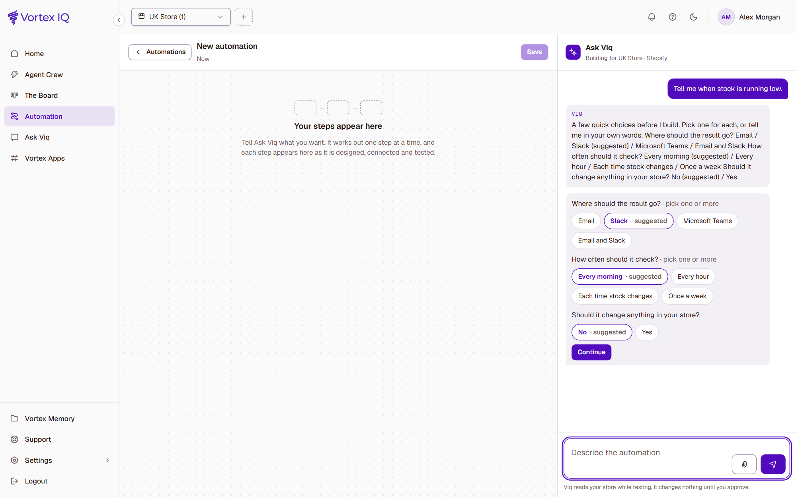
</Frame>

Pick an answer for each question and select **Continue**. You can also type your own answer in the message box instead.

## Step 4: Watch Ask Viq plan the steps

Ask Viq reads your request, checks which of your apps are ready, and works out the steps. The chat shows what it is doing, line by line.

<Frame>
  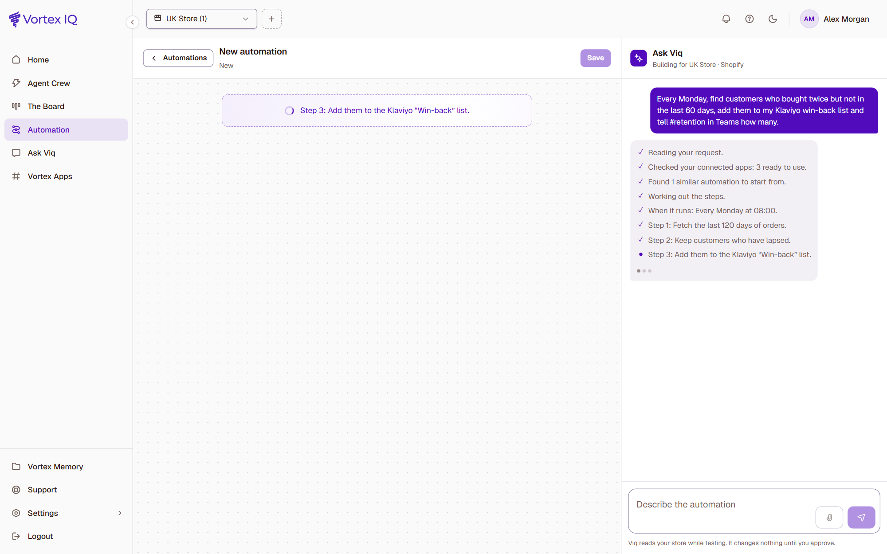
</Frame>

When the plan is ready, the left side fills in:

- **A trigger card at the top** says when the automation runs, for example "Every Monday at 08:00".
- **One card for each step**, in the order they run.

## Step 5: Let each step be built and tested

Ask Viq now builds the steps one at a time. For each step it designs the step, checks the apps it needs, and tests it on your store's data. You do not need to do anything while this happens.

<Frame>
  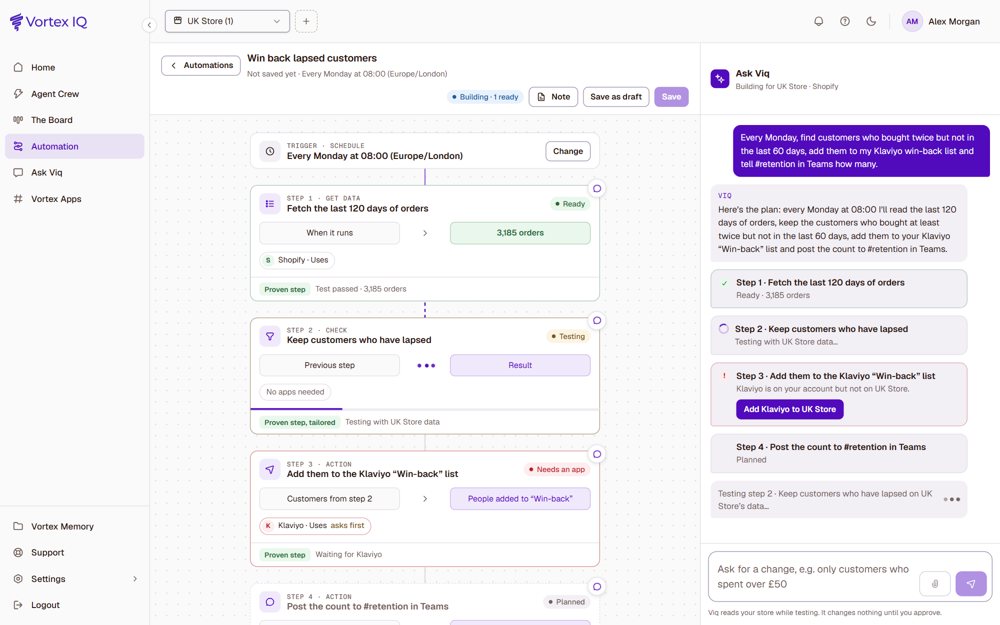
</Frame>

Each step card and each line in the chat shows where the step is:

| Status | What it means |
| --- | --- |
| **Planned** | The step is in the plan. Work on it has not started. |
| **Designing** | Ask Viq is working out how the step does its job. |
| **Checking apps** | Ask Viq is checking that the apps the step needs are connected. |
| **Testing** | The step is running on your store's data as a test. |
| **Ready** | The step passed its test. |
| **Needs an app** | An app the step uses is not connected on this store profile. See below. |
| **Not supported yet** | No app can do this step yet. You can ask Vortex IQ to add the app. |
| **Needs help** | Ask Viq tried three times and could not get the step to work. See [If a step needs help](#if-a-step-needs-help). |

<Note>
  A test reads your live store data. It never changes or sends anything. A step that would make a change, such as adding people to a list or posting a message, is previewed instead. The card says what it would do, for example "212 would be added".
</Note>

### Connect an app when a step needs one

If a step needs an app that is not ready, the build pauses at that step and the chat tells you which app is missing.

<Frame>
  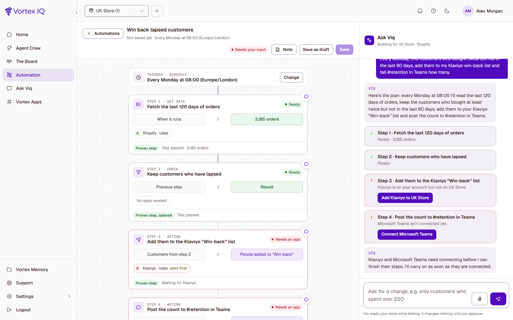
</Frame>

Select the button under that step in the chat. Which button you see depends on the app:

- **A connect button**, such as **Connect Microsoft Teams**, opens Vortex IQ's own connection form for the app. Sign in to the app there. If the app's sign-in page cannot open inside the window, select **Continue in a new tab**, finish there and come back. Then select **Check again**.
- **An add button**, such as **Add Klaviyo to UK Store**, appears when the app is already connected on your account but not on this store profile. Select **Open the profile**, add the app to the profile, and come back.
- **An ask button**, such as **Ask Vortex to add Royal Mail Click & Drop**, appears when Vortex IQ cannot use the app in automations yet. Say what you need it for and select **Send request**.

<Frame>
  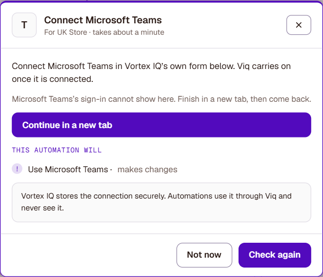
</Frame>

As soon as the app is connected, Ask Viq carries on with the steps that were waiting. More about apps is on the [Connections](/automations/connections) page.

## Step 6: Review the steps

When every step has passed its test, the header shows that all steps are ready, for example **All 4 steps ready**, and Ask Viq tells you to save when you are ready.

<Frame>
  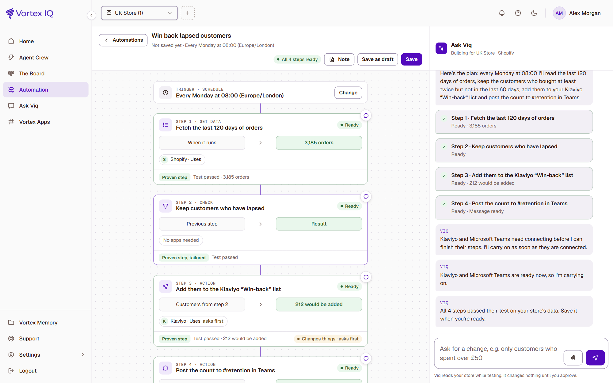
</Frame>

### What a step card tells you

| Part of the card | What it tells you |
| --- | --- |
| The top line | The step number and its kind: **Get data** reads something, **Check** works on what earlier steps found, **Action** changes or sends something. |
| The two boxes with an arrow | What the step takes in and what it gives. After the test, the second box shows the result, such as "3,185 orders". |
| The app labels | The apps the step uses. **asks first** marks an app the step changes something in. |
| The bottom line | **Proven step** means the step already runs on other stores. **Proven step, tailored** means it was adjusted for your request. **Built for you** means it was written for this automation. |
| **Changes things · asks first** | The step changes or sends something. You approve this when you save. |

### Look inside a step

Select a step card to open **Step details** beside it.

<Frame>
  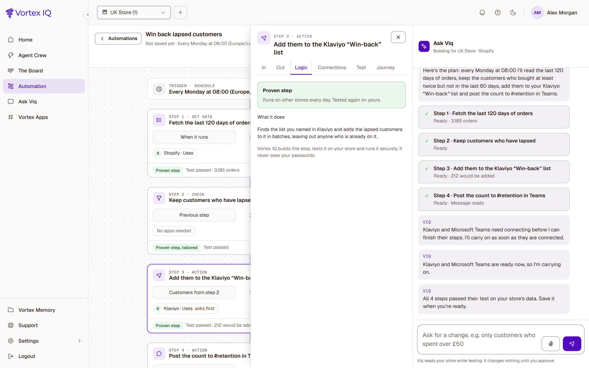
</Frame>

| Tab | What you see |
| --- | --- |
| **In** | What the step uses, and its settings, such as a list name or a number of days. |
| **Out** | What the step produces, and which step gets it next. |
| **Logic** | A plain description of what the step does. |
| **Connections** | The apps the step uses, whether each is connected, and what the step may do in each app. |
| **Test** | The result of the test. For a step that changes something, it says what the step would do. |
| **Journey** | What happened to the step while it was built and tested, in order. |

<Frame>
  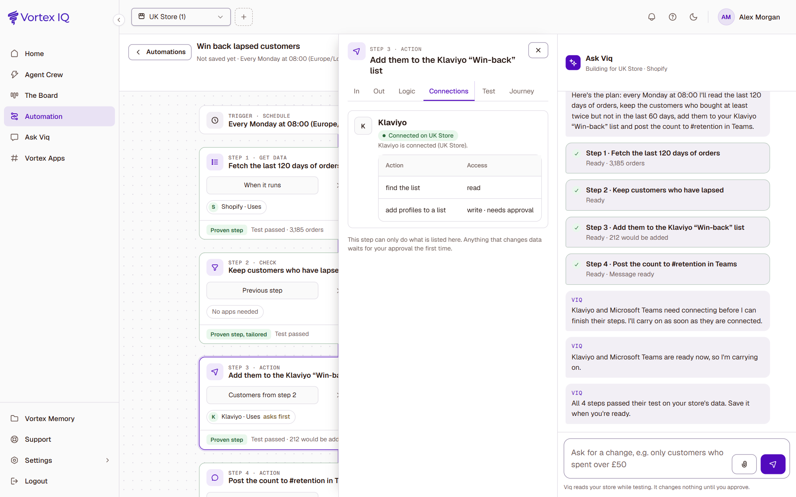
</Frame>

<Frame>
  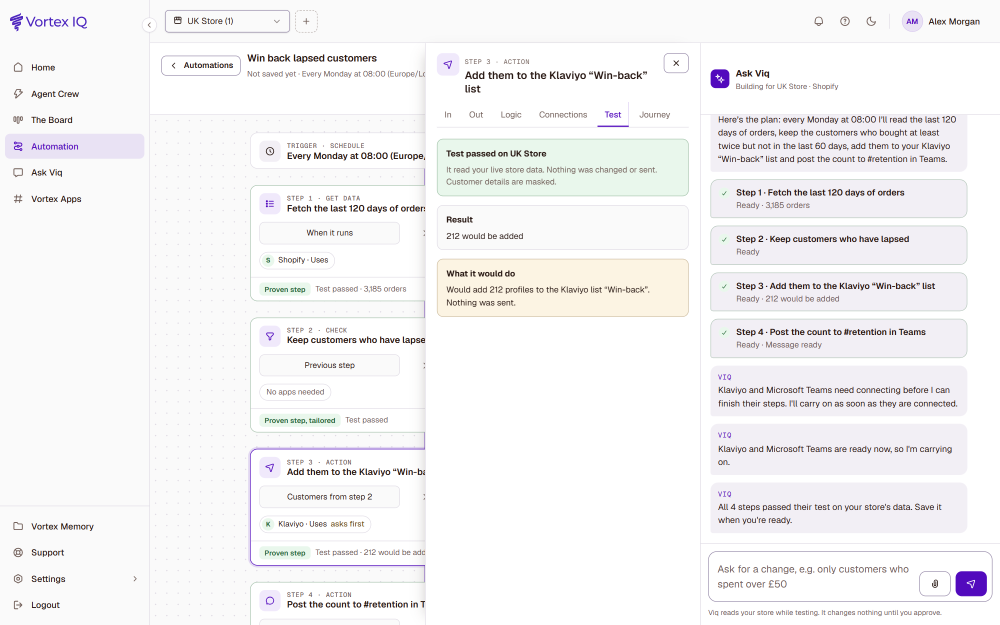
</Frame>

<Frame>
  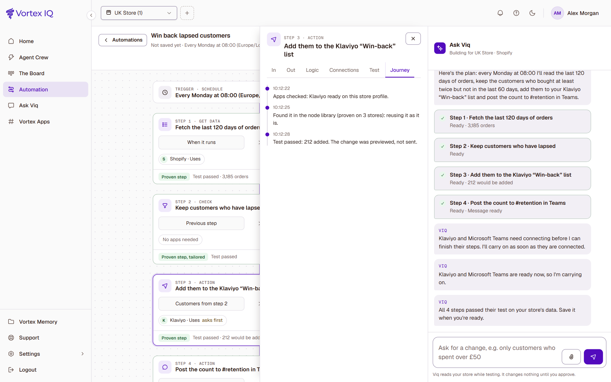
</Frame>

### Change something before you save

Tell Ask Viq in the chat, in plain words. For example: "Only customers who spent over £50" or "Post to #marketing instead".

To ask about one step, select the chat icon on the corner of its card. Your next message is then about that step. Ask Viq rebuilds only the steps your change touches and tests them again.

## Step 7: Save and approve

Select **Save** in the header. The button is available once every step is ready.

<Frame>
  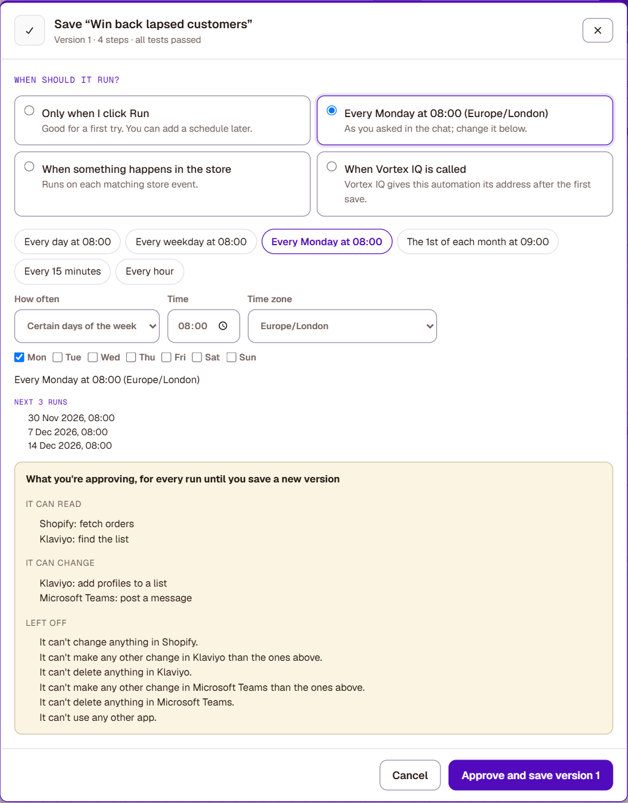
</Frame>

**1. Choose when it runs.**

| Choice | When the automation runs |
| --- | --- |
| **Only when I click Run** | Only when you start it yourself. Good for a first try. |
| **On a schedule** | At the times you set. If you gave a time in the chat, it is already filled in. |
| **When something happens in the store** | Each time the store sends the event you described, such as a paid order. |
| **When Vortex IQ is called** | When another system calls a web address that Vortex IQ gives the automation. |

For a schedule, pick one of the ready-made times or set your own under **How often**, **Time** and **Time zone**. **Next 3 runs** shows when it will run next. More detail is on [Schedules and the calendar](/automations/schedules-and-calendar).

**2. Read what you are approving.** The box lists, in plain words:

- **It can read:** what the automation may read in each app.
- **It can change:** the changes it may make, such as adding people to a list or posting a message.
- **Left off:** what it cannot do, such as deleting anything or using any other app.

If the window shows **Checks on the test**, Ask Viq also checked that the test results make sense. A check that did not pass must be fixed in the chat before you can save.

**3. Select the approve button**, for example **Approve and save version 1**. Your approval covers every run of this version. The automation does not ask again each time it runs. When you later change the automation and save a new version, you approve again.

<Note>
  An automation that uses no apps has nothing to approve, so the button reads **Save version 1**.
</Note>

## Step 8: Run it

After you save, the header shows the version, when it runs, and a **Run now** button.

<Frame>
  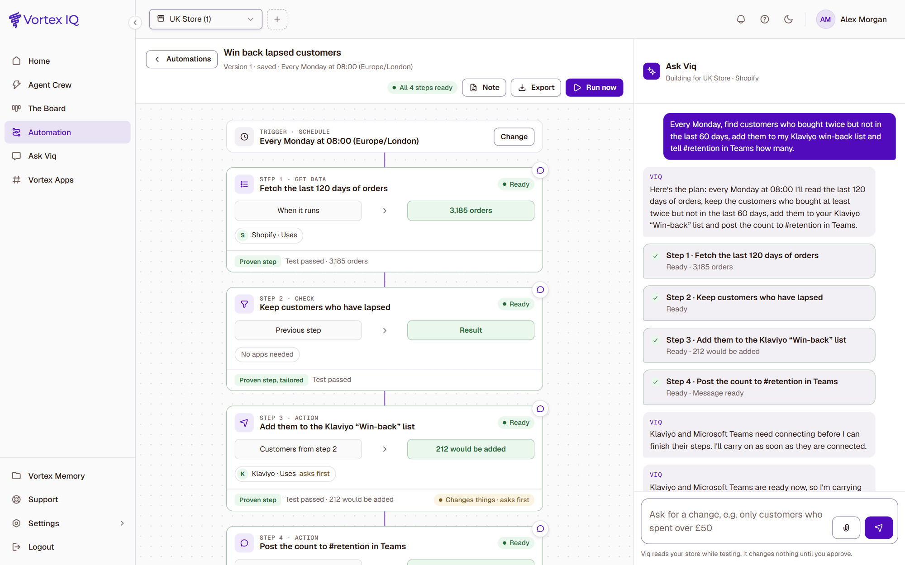
</Frame>

- A scheduled automation starts by itself at its next time. You can still select **Run now** to try it at once.
- If the automation cannot start by itself yet, the chat says why and what to do, in a line that starts with "It does not run on its own yet".
- If you chose **When Vortex IQ is called**, the chat shows the automation's address once, right after the first save. Copy it then. It is not shown again.

What you can do next with the saved automation is on [Manage your automations](/automations/manage-automations).

## If a step needs help

Sometimes a step cannot be built. Its card shows **Needs help** and says why, often with the answer the app gave.

Select the card, open the **Logic** tab, and choose:

- **Ask Viq to change it.** The chat opens with "Change step" already typed. Say what the step should do instead.
- **Carry on without it.** Ask Viq plans the automation again without that step.

You can also answer in the chat directly. If the reason is a missing detail, such as which page to check or who an email should go to, give that detail.

## Come back later

You do not have to finish in one go.

- **Save as draft** in the header keeps the build as it is, even if a step still needs help. You find it on the **Automations** tab with the status **Draft**. Open it to carry on where you stopped.
- A draft is visible only to you, and only on the store profile you built it on.
- If you ask for the same thing again later, Ask Viq offers **Open that build** or **Build it again**.
- A build that was never saved and not kept as a draft is deleted 30 days after its last change.

## Bring in a workflow from a file or a picture

Select the paperclip button beside the message box to attach one file or picture to your message.

| You attach | What Ask Viq does |
| --- | --- |
| A workflow exported from n8n or Shopify Flow | Reads the workflow and plans the same job as steps. Passwords and keys in the file are removed before anything is kept. |
| A file exported from Vortex IQ | Rebuilds the same steps and schedule. Attach it to a new, empty chat. |
| A picture of a workflow | Builds what the picture shows. |

A file can be up to 4 MB and a picture up to 3 MB. Pictures can be PNG, JPEG or WebP. You can add a sentence to say what should be different.

## Tips for a good result

- Say **when** it should run. If you do not, you can still choose when it runs in the Save window.
- Name the app and the place: "post to #sales in Slack", "add to my Klaviyo list called Win-back".
- Give numbers where they matter: "below 10 in stock", "not in the last 60 days".
- Start small. Save a simple version, run it, then ask Ask Viq to add more.
