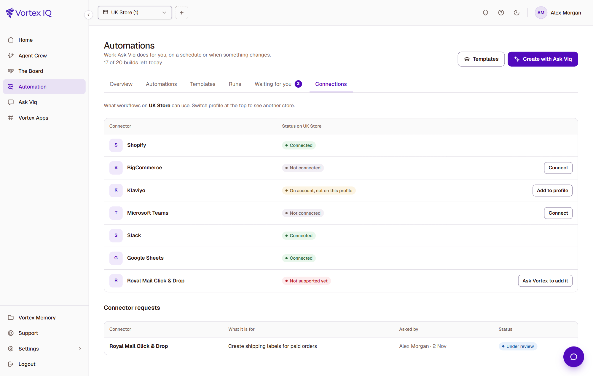
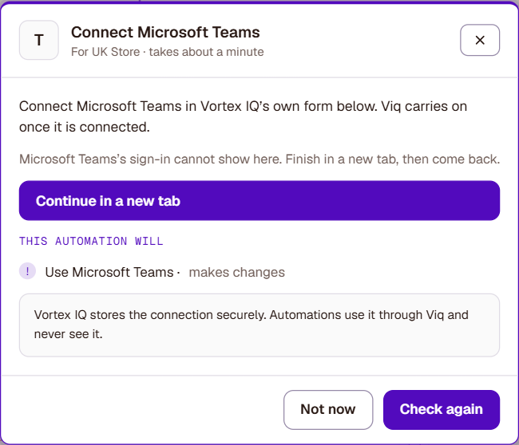
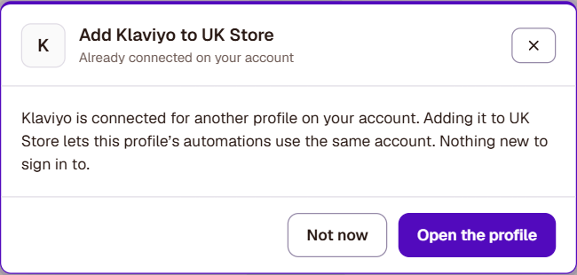
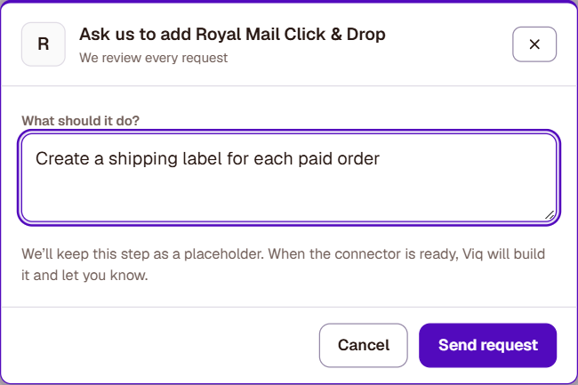

An automation works through the apps you have connected to Vortex IQ: your store, and tools such as Slack, Microsoft Teams, Klaviyo or Google Sheets. The **Connections** tab shows which apps automations on this store profile can use.

<Frame>
  
</Frame>

The list is for the store profile selected at the top of the page. To see another store's apps, switch profile there.

## Read the list

| Status | What it means | What you can do |
| --- | --- | --- |
| **Connected** | Automations on this store profile can use the app. | Nothing. It is ready. |
| **On account, not on this profile** | The app is connected on your account, but for another store profile. | Select **Add to profile**. |
| **Not connected** | The app is not connected yet. | Select **Connect**. |
| **Expired · reconnect** | The connection stopped working, for example because the sign-in ran out. | Select **Connect** and sign in again. |
| **Not supported yet** | Vortex IQ cannot use this app in automations yet. | Select **Ask Vortex to add it**. |

<Note>
  Only a workspace admin can connect an app or add one to a store profile. If you are not an admin, the window offers **Ask an admin** instead.
</Note>

## Connect an app

1. Select **Connect** beside the app.
2. A window opens with Vortex IQ's own connection form for that app. Sign in to the app there.
3. If the app's sign-in page cannot open inside the window, select **Continue in a new tab**. Finish there, then come back.
4. Select **Check again**. When the app is connected, the window says so and closes.

<Frame>
  
</Frame>

When you connect from inside an automation, the window also lists what that automation will do with the app, and whether each action only reads or makes changes.

Vortex IQ stores the connection securely. An automation uses the app through Vortex IQ and never sees your password or key.

<Tip>
  You can also connect apps ahead of time in **Settings**, under **Connected Sources**.
</Tip>

## Add an app to this store profile

If an app is already connected for another store profile, you do not have to sign in again.

<Frame>
  
</Frame>

1. Select **Add to profile**.
2. Select **Open the profile**. The store profile opens in a new tab.
3. Add the app to the profile there, and come back.

The window waits and closes by itself once the app is on the profile.

## Ask Vortex IQ to add an app

If an app is **Not supported yet**, you can ask for it.

<Frame>
  
</Frame>

1. Select **Ask Vortex to add it**.
2. Under **What should it do?**, say what you want the app to do in your automation.
3. Select **Send request**.

Your request appears under **Connector requests** at the bottom of the tab, with who asked, when, and its status. Vortex IQ reviews every request.

If you asked from inside a build, the step stays in the automation as a placeholder until the app is ready.

## Connect while you build

You do not have to visit this tab first. When a step needs an app that is not ready, the chat offers the right button under that step, and Ask Viq carries on as soon as the app is connected. See [Connect an app when a step needs one](/automations/build-with-ask-viq#connect-an-app-when-a-step-needs-one).

## Good to know

- Templates check these connections too. A template that shows **Needs** and an app name is waiting for that app.
- If an app's connection expires, runs that use it fail, and the run tells you to reconnect the app.
- Disconnecting an app is done in **Settings**, under **Connected Sources**. Automations that use it stop working until it is connected again.
