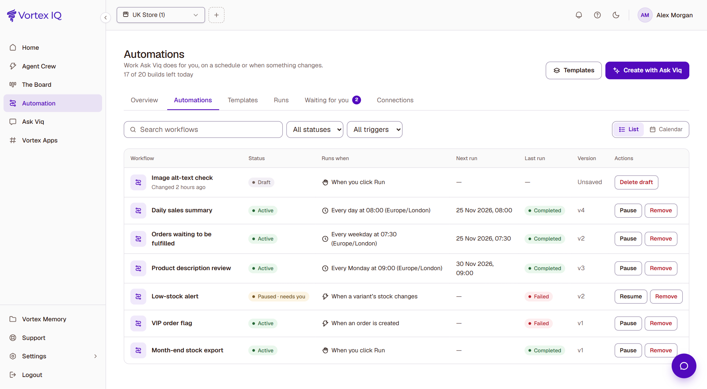
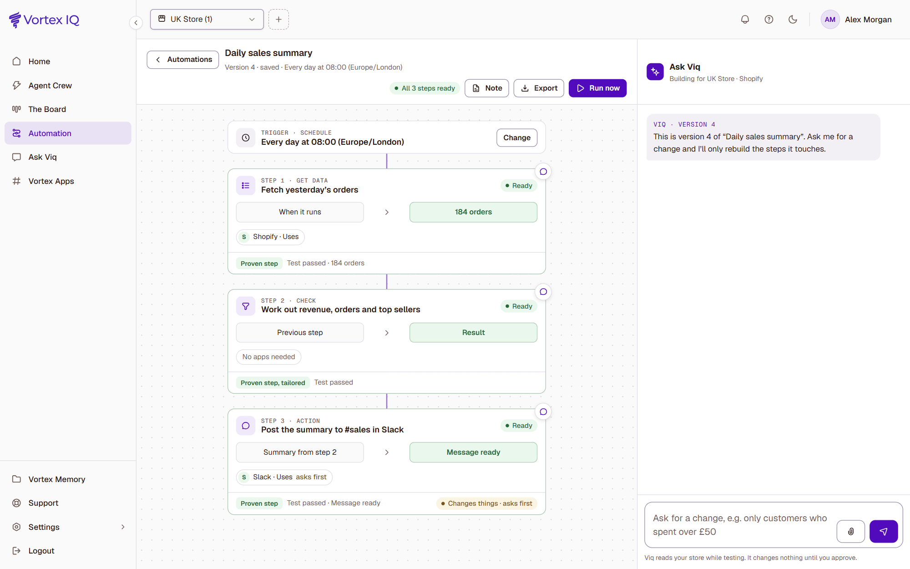
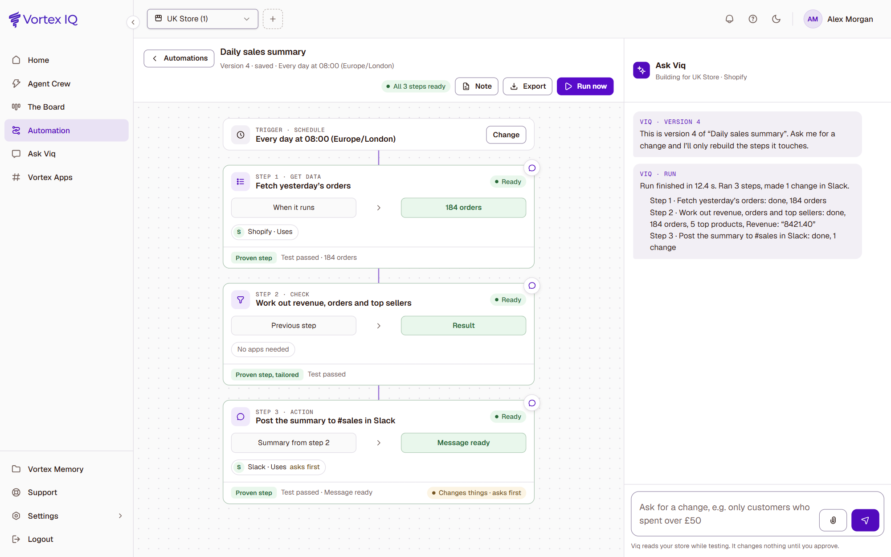
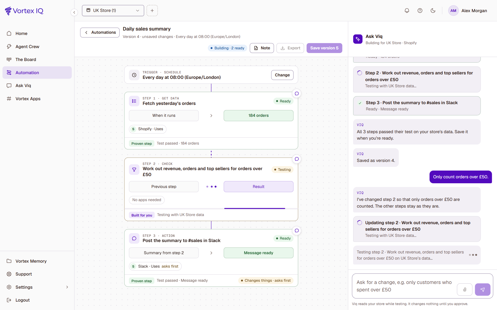
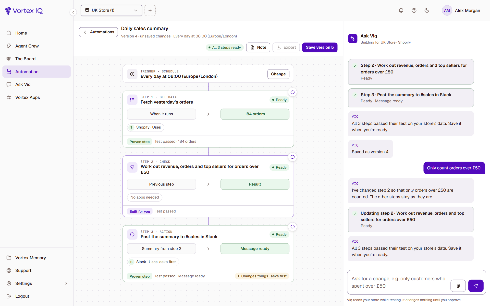
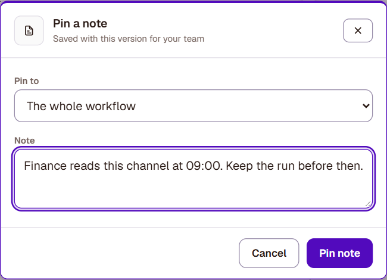
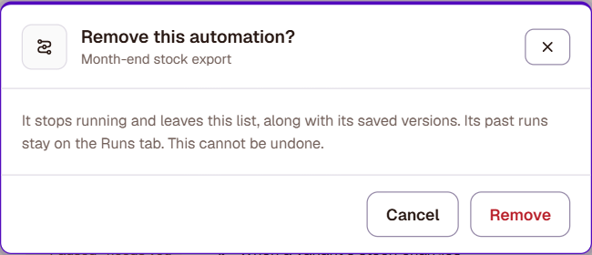

The **Automations** tab lists your workspace's saved automations, and the drafts you started on the store profile you have selected.

<Frame>
  
</Frame>

## Read the list

| Column | What it shows |
| --- | --- |
| **Workflow** | The automation's name. A draft also shows when it last changed. |
| **Status** | Whether it is switched on. See the table below. |
| **Runs when** | Its schedule, the store event that starts it, or "When you click Run". |
| **Next run** | The next scheduled run, in your own time zone. Automations without a schedule show a dash. |
| **Last run** | How the most recent run ended, such as **Completed** or **Failed**. |
| **Version** | The saved version, such as v4. A draft shows **Unsaved**. |
| **Actions** | **Pause** or **Resume**, and **Remove**. A draft has **Delete draft**. |

| Status | What it means |
| --- | --- |
| **Active** | Switched on. It runs by its schedule or trigger. |
| **Paused** | Switched off. Nothing runs until you resume it. |
| **Paused · needs you** | Paused, and a fix is waiting for your decision on the [Waiting for you](/automations/waiting-for-you) tab. |
| **Draft** | A build you kept but have not saved as an automation yet. |
| **Not running** | Saved, but it cannot start by itself yet. Open it and save it again. The chat then says what is missing. |

### Find an automation

- Type part of its name in **Search workflows**.
- Filter by status with **All statuses**, or by how it starts with **All triggers**: **Schedule**, **Store event**, **Manual** or **HTTP call**.
- If nothing matches, select **Clear filters**.
- Select **Calendar** to see scheduled runs on a calendar instead. See [Schedules and the calendar](/automations/schedules-and-calendar).

## Open an automation

Select its row. A saved automation opens with its steps on the left and the Ask Viq chat on the right. A draft opens in the builder, as you left it.

<Frame>
  
</Frame>

| In the header | What it does |
| --- | --- |
| **Automations** | Goes back to the list. |
| The line under the name | The saved version and when the automation runs. |
| **Note** | Pins a note for your team. |
| **Export** | Downloads the saved version as a file. |
| **Run now** | Starts a run at once. |

Select a step card to see what it uses, what it produces and how its test went. See [Look inside a step](/automations/build-with-ask-viq#look-inside-a-step).

## Run it now

Select **Run now**. The run starts at once, whatever its schedule says. The chat shows that it is running and then the result, with one line for each step.

<Frame>
  
</Frame>

If a run takes longer than three minutes, the chat stops waiting and tells you the result will be on the **Runs** tab. Every run is listed there. See [Runs and results](/automations/runs-and-results).

<Note>
  **Run now** is available for a saved automation with no unsaved changes. After you change something, the button becomes **Save version** and a number. Save first, then run.
</Note>

## Change it by chat

Type the change in the chat, in plain words. For example: "Only count orders over £50."

Ask Viq works out which steps your change touches, rebuilds only those, and tests them again. The other steps stay as they are.

<Frame>
  
</Frame>

When the changed steps have passed their test, the header shows **unsaved changes** and a **Save version** button with the next number.

<Frame>
  
</Frame>

Select the **Save version** button to make the change live. The Save window opens again, and you approve what the new version can read and change. Anything the last version could not do is listed under **New in this version**.

Until you save, the automation keeps running as the last saved version.

## Change when it runs

Select **Change** on the trigger card at the top of the steps. The Save window opens. Choose when the automation should run and save the new version.

You can also change a schedule from the calendar. See [Schedules and the calendar](/automations/schedules-and-calendar).

## Pin a note

A note is a reminder for you and your team, such as why the automation runs at a certain time.

<Frame>
  
</Frame>

1. Select **Note** in the header.
2. Under **Pin to**, choose **The whole workflow** or one step.
3. Type the note and select **Pin note**.

The note appears under the step, or under the last step for the whole workflow. Notes are saved with the version, so on a saved automation, save the new version to keep the note.

## Export an automation

Select **Export**, then **Export** again to confirm. The saved version downloads as a file.

The file holds the automation's name, when it runs, and each step with its settings, including any email addresses in them. It holds no keys and no connections. Whoever brings the file in connects their own apps.

To bring a file in, attach it to a new chat in the builder. See [Bring in a workflow from a file or a picture](/automations/build-with-ask-viq#bring-in-a-workflow-from-a-file-or-a-picture).

<Note>
  **Export** always downloads the saved version. If the automation has unsaved changes, save them first.
</Note>

## Pause and resume

On the list, select **Pause** to switch an automation off. Nothing runs while it is paused, and a scheduled automation's coming runs do not start. Select **Resume** to switch it on again.

Both take effect at once. Starts that arrive while an automation is paused, such as a store event, are not acted on later.

## Remove an automation or delete a draft

On the list, select **Remove**. A window asks you to confirm.

<Frame>
  
</Frame>

- **A removed automation** stops running and leaves the list, along with its saved versions. Its past runs stay on the **Runs** tab. This cannot be undone.
- **A deleted draft** loses its steps and its chat. It cannot be brought back.

<Tip>
  If you only want an automation to stop for a while, pause it instead. A paused automation keeps its steps, its schedule and its history.
</Tip>
