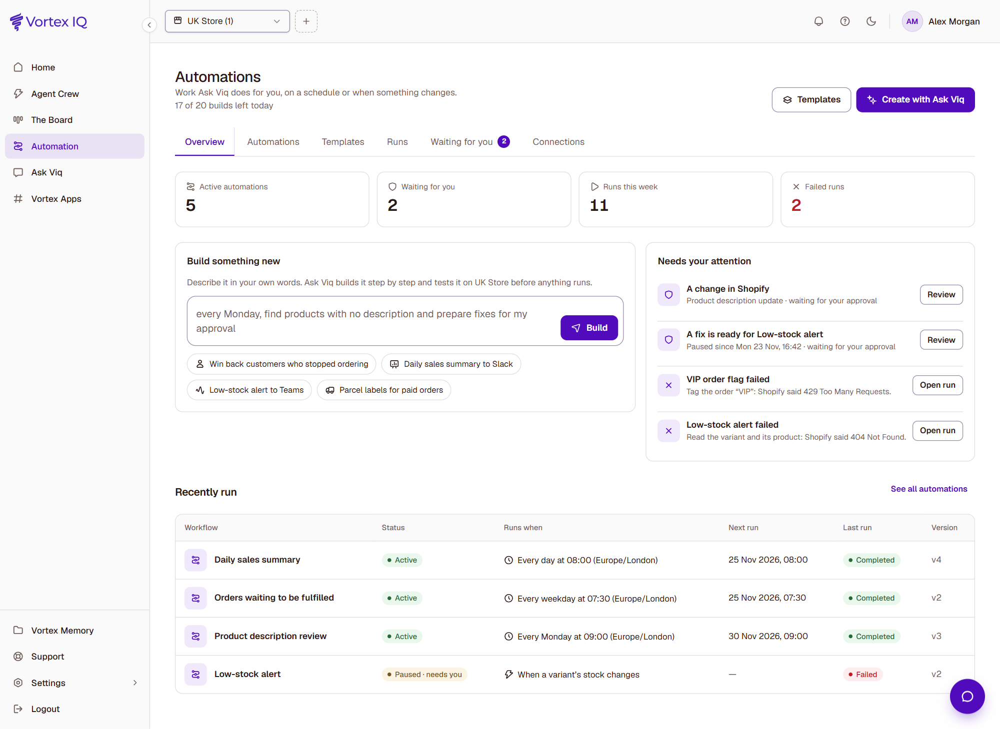
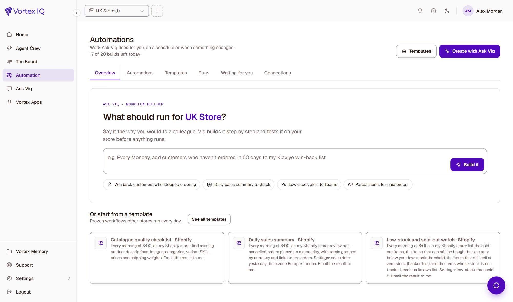

An automation is a job Vortex IQ does for you. It runs on a schedule, when something happens in your store, or when you select **Run now**.

You do not draw a flow or write code. You describe the job in your own words. Ask Viq turns it into steps, tests each step on your store's data, and shows you what the automation will read and change before anything runs.

A few things people automate:

- Every morning, post yesterday's sales to a Slack channel.
- Every Monday, find customers who stopped ordering and add them to a win-back list.
- When a product's stock runs low, send an alert.
- Every morning, email a list of orders that are still waiting to be shipped.

<Frame>
  
</Frame>

## Where to find it

Select **Automation** in the left menu. The **Automations** page opens on the **Overview** tab.

A new automation is built for the store profile you have selected at the top of the page. Its templates, its apps and its tests all follow that profile. To build for another store, switch profile there first.

## The page at a glance

| Tab | What it is for |
| --- | --- |
| **Overview** | A summary: how many automations are active, what is waiting for you, and how recent runs went. You can also start a new automation from here. |
| **Automations** | Your workspace's saved automations, and your own drafts. Switch between a list and a calendar. |
| **Templates** | Ready-made automations you can start from. |
| **Runs** | Each time an automation ran, with the result of every step. |
| **Waiting for you** | Changes and fixes that need your approval. The number on the tab shows how many are waiting. |
| **Connections** | The apps that automations on the selected store profile can use. |

Two buttons stay at the top right of every tab: **Templates** opens the template list, and **Create with Ask Viq** starts a new automation. The round chat button at the bottom right also starts a new automation.

### The Overview tab

- **The four tiles** show active automations, items waiting for you, runs in the last seven days and failed runs. Select a tile to open its tab.
- **Build something new** starts an automation. Describe it and select **Build**, or pick one of the examples.
- **Needs your attention** lists approvals that are waiting and runs that failed. Select **Review** or **Open run**.
- **Recently run** shows up to four saved automations. Select a row to open it, or **See all automations** for the full list.

## Your first visit

While there is no automation yet, the page shows a welcome box and a few templates.

<Frame>
  
</Frame>

Describe what you want and select **Build it**, pick an example, or choose a template under **Or start from a template**.

## Two ways to make an automation

<CardGroup cols={2}>
  <Card title="Build with Ask Viq" icon="comments" href="/automations/build-with-ask-viq">
    Describe the job in a sentence. Ask Viq plans the steps, tests them and waits for you to save.
  </Card>
  <Card title="Start from a template" icon="layers" href="/automations/use-a-template">
    Pick a proven automation. Ask Viq rebuilds it for your store and tests it before you save.
  </Card>
</CardGroup>

## How your store stays safe

- **A test never changes anything.** While it builds, Ask Viq reads your store to test each step. A step that would change something is previewed, not sent.
- **You approve before it runs.** When you save, the page lists what the automation can read and what it can change. Saving is your approval.
- **An automation can only do what its steps list.** Anything else in your apps is refused.
- **Keys and passwords never go in the chat.** You connect apps in Vortex IQ's own connection form. If a message looks like a key, Ask Viq refuses it.
- **Customer details stay private.** They are masked in tests, and a run shows counts and results, not your customers' details.

## Who can do what

- Anyone who can open the page can build, save, run and review automations.
- Only a workspace admin can connect an app or add an app to a store profile. If you are not an admin, select **Ask an admin** and the automation carries on once the app is connected.
- A draft is visible only to the person who started it.

## How many automations you can build in a day

Under the page title you may see a line such as "17 of 20 builds left today". Each new automation you start counts as one build. Changing an automation you already started does not use a build.

When none are left, the line says when the next one is available. The limit depends on your workspace.

## Where to go next

<CardGroup cols={2}>
  <Card title="Manage your automations" icon="workflow" href="/automations/manage-automations">
    Open, run, change, pause and remove automations.
  </Card>
  <Card title="Schedules and the calendar" icon="calendar" href="/automations/schedules-and-calendar">
    Choose when an automation runs, and move or skip a run.
  </Card>
  <Card title="Runs and results" icon="activity" href="/automations/runs-and-results">
    See what each run did, and what to do when one fails.
  </Card>
  <Card title="Waiting for you" icon="clipboard-check" href="/automations/waiting-for-you">
    Approve changes and fixes.
  </Card>
  <Card title="Connections" icon="plug" href="/automations/connections">
    Connect the apps your automations use.
  </Card>
  <Card title="Troubleshooting" icon="wrench" href="/automations/troubleshooting">
    Answers to common questions.
  </Card>
</CardGroup>
