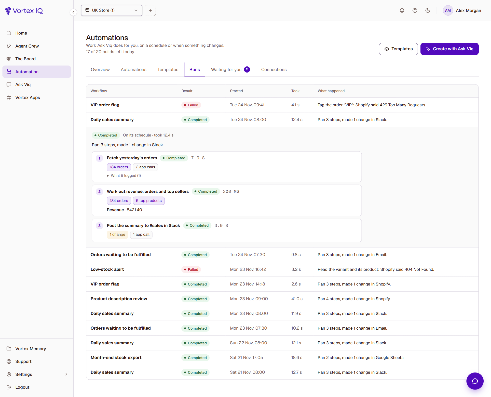
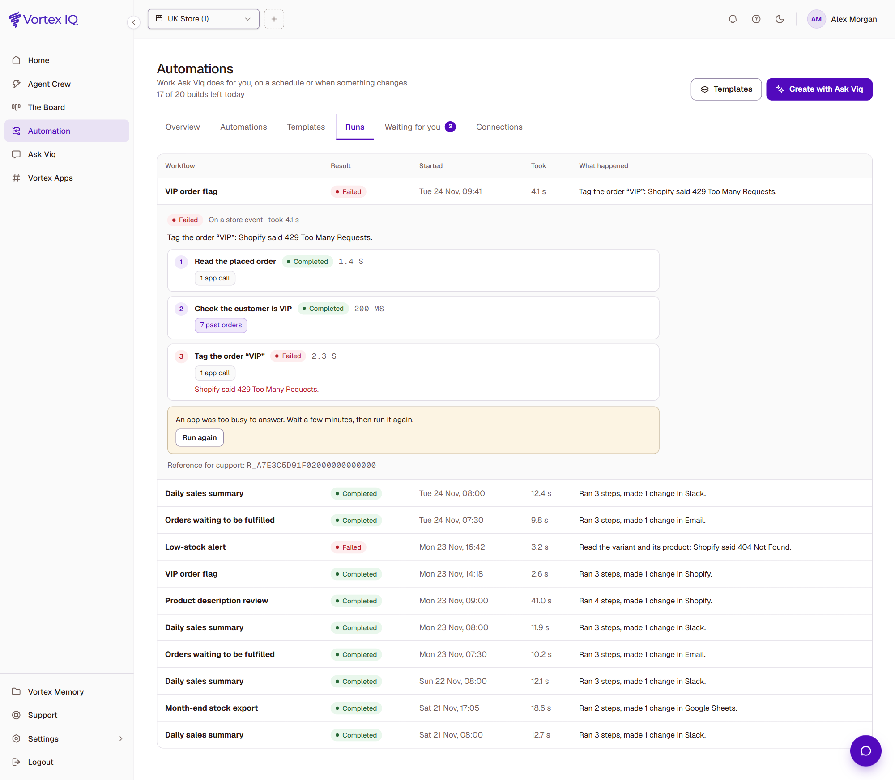

A run is one time an automation did its job. The **Runs** tab lists the most recent runs of every automation, newest first.

## Read the list

| Column | What it shows |
| --- | --- |
| **Workflow** | The automation that ran. |
| **Result** | How the run ended. See the table below. |
| **Started** | When the run started. |
| **Took** | How long it took. |
| **What happened** | A one-line summary, such as "Ran 3 steps, made 1 change in Slack." For a failed run, the step that failed and why. |

| Result | What it means |
| --- | --- |
| **Completed** | Every step finished. |
| **Failed** | A step could not finish. The steps after it did not run. |
| **Running** | The run is under way. |
| **Queued** | The run is waiting to start. |
| **Cancelled** | The run was stopped before it finished. |

## Open a run

Select a row to open the run under it. Select the row again to close it.

<Frame>
  
</Frame>

At the top you see the result, how the run started and how long it took. A run starts in one of four ways: **On its schedule**, **On a store event**, **Run by hand** or **When it was called**.

Then each step is listed in order:

| On a step | What it tells you |
| --- | --- |
| The result and time | Whether the step **Completed**, **Failed** or **Did not run**, and how long it took. |
| The counts | What the step found, such as "184 orders". |
| **changes** | How many changes the step made in your apps, such as a message posted or a list updated. |
| **app calls** | How many times the step asked an app for something. |
| A named value | One short result the step was asked to show, such as "Revenue 8421.40". |
| **What it logged** | Notes the step wrote while it ran. Select it to read them. |

<Note>
  A run shows counts and short results, never your customers' details. If a step was asked to show a value that could contain people's details, the run says the value is not shown. Its numbers are still shown.
</Note>

## When a run fails

A failed run tells you three things: which step failed, why, and what to do next.

<Frame>
  
</Frame>

1. **Read the step that failed.** The red line says what went wrong, often in the app's own words.
2. **Read the advice under the steps.** It says in plain words what to do. The table below lists the usual cases.
3. **Select Run again** when you are ready. The run starts again with what started it the first time, for example the same store event.

| What the run says | What to do |
| --- | --- |
| An app did not accept its connection. | Reconnect that app on the [Connections](/automations/connections) tab, then run again. |
| An app refused this because its connection does not allow it. | Reconnect the app and allow the access it asks for, then run again. |
| This automation is not approved to use one of its apps. | Open the automation and save it again to approve it, then run again. |
| An app was too busy to answer, was not working, or could not be reached. | Wait a few minutes, then run again. |
| This run tried to do more than one run allows. | Open the automation and ask Ask Viq to make it do less. |
| An app did not accept what a step sent, or a step could not finish its own work. | Open the automation and ask Ask Viq to fix that step. |
| This was a problem on Vortex IQ's side. | Run it again. If it fails again, contact support. |

<Warning>
  **Run again** runs every step again. If the failed run already made changes before it failed, the run says how many, and running it again makes those changes again.
</Warning>

### If Vortex IQ is already fixing it

When a step broke because of something that can be repaired, Vortex IQ pauses the automation and prepares a fix by itself. The failed run then shows a notice and the **See it in Waiting for you** button instead of **Run again**. Review the fix on the [Waiting for you](/automations/waiting-for-you) tab.

### Contact support about a run

Every failed run ends with **Reference for support** and a code. Send that code to Vortex IQ support so they can find the run.

## Other places you see results

- **In the chat.** After **Run now**, the result appears in the automation's chat, with one line for each step.
- **On the list.** The **Last run** column on the **Automations** tab shows how each automation's most recent run ended.
- **On the Overview.** **Failed runs** counts the failed runs of the last seven days, and **Needs your attention** lists them with an **Open run** button.

## Good to know

- If the tab says "No runs yet", no automation has run on this workspace so far. Each run appears here once it starts.
- The list holds the most recent runs. Very old runs drop off it.
- A run started by **Run now** counts like any other run and is listed here.
