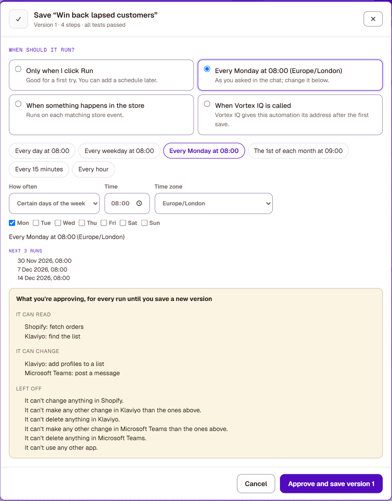
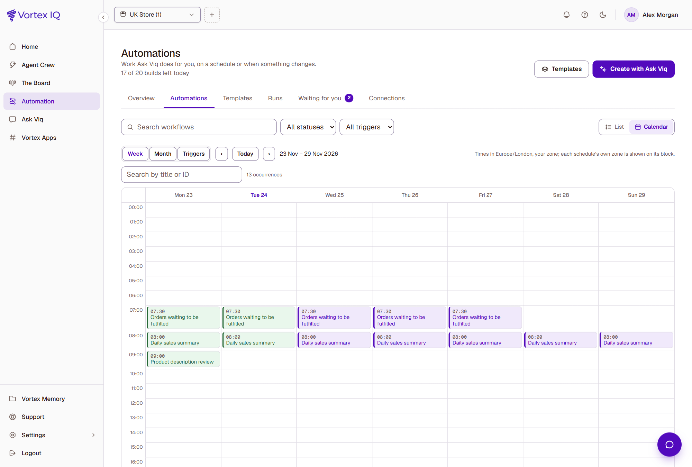
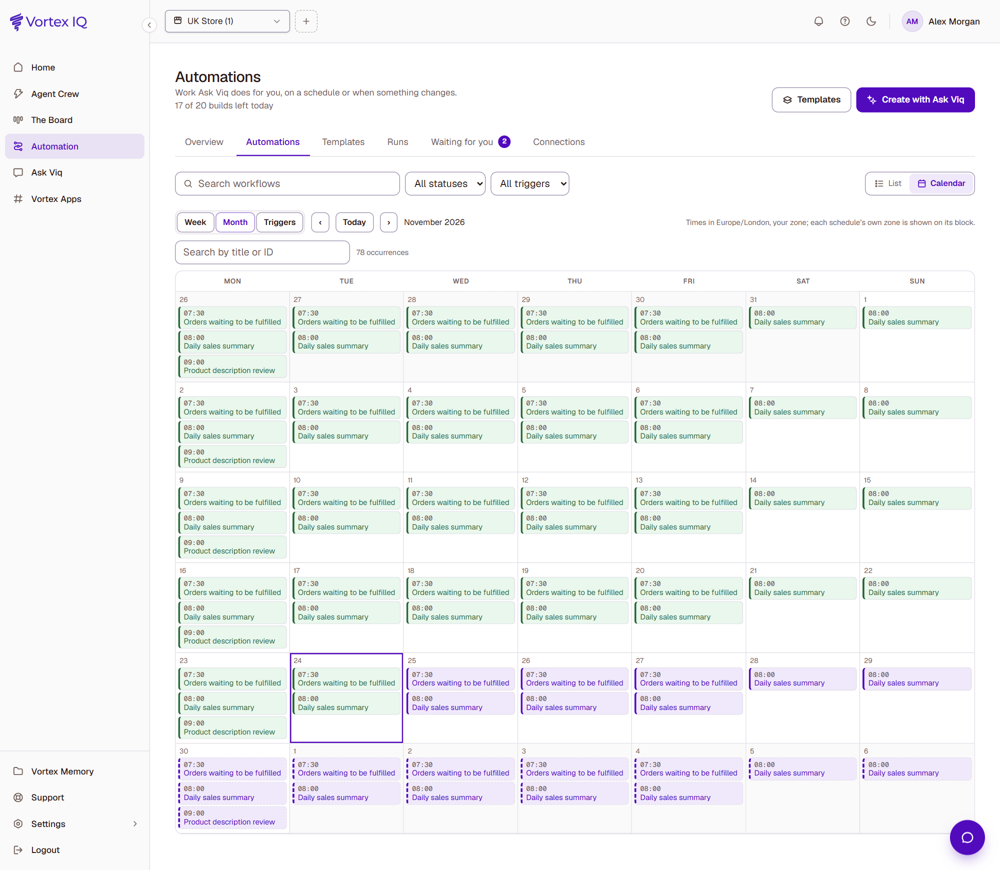
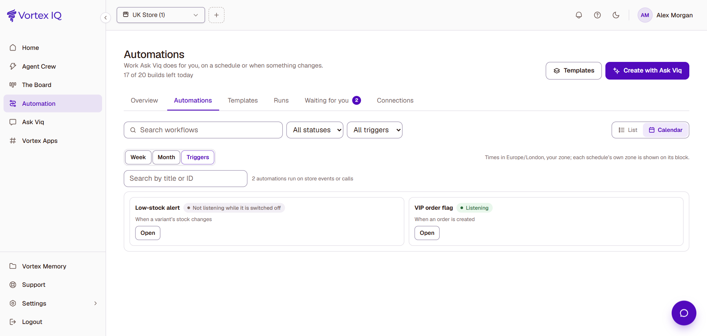
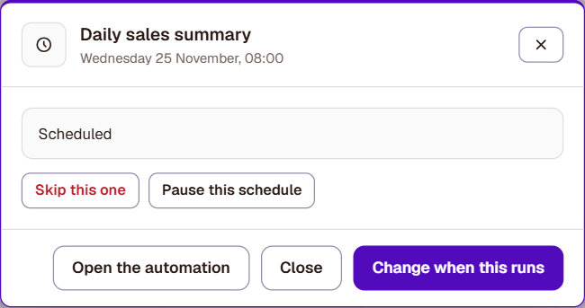

Every automation has a trigger: the thing that starts it. You choose it when you save, and you can change it later.

## How an automation can start

| Trigger | When it runs | How you set it |
| --- | --- | --- |
| **Schedule** | At times you set, such as every day at 08:00. | Say it in your request, or choose it in the Save window. |
| **Store event** | Each time something happens in your store, such as a paid order or a stock change. | Say it in your request, for example "When an order is paid". |
| **Manual** | Only when you select **Run now**. | Choose **Only when I click Run** in the Save window. |
| **HTTP call** | When another system calls a web address that belongs to the automation. | Choose **When Vortex IQ is called** in the Save window. |

<Note>
  For **When Vortex IQ is called**, the chat shows the automation's address once, right after the first save. Copy it then. It is not shown again.
</Note>

## Set a schedule

The same schedule controls appear in three places: the Save window, the **Change** button on a draft's trigger card, and **Change when this runs** on the calendar.

<Frame>
  
</Frame>

1. Pick a ready-made schedule, such as **Every day at 08:00**, **Every weekday at 08:00** or **Every Monday at 08:00**.
2. Or set your own with **How often**:

   | How often | What you set |
   | --- | --- |
   | **Every day** | The time. |
   | **Certain days of the week** | The time and the days. |
   | **A day of the month** | The time and the day, from 1 to 28 or the last day. |
   | **A weekday of the month** | The time, and for example the first Monday or the last Friday. |
   | **Every few minutes** | Every 5, 10, 15, 20 or 30 minutes. |
   | **Every few hours** | Every 1, 2, 3, 4, 6, 8 or 12 hours, and the minute past the hour. |
   | **Once** | One date and time. |

3. Choose the **Time zone** the times are in.
4. Check the sentence under the controls. It says the schedule in words, such as "Every Monday at 08:00 (Europe/London)".
5. Check **Next 3 runs**. They are shown in your own time. If the schedule uses another time zone, its time is shown beside yours.

If something is missing, such as a day of the week, the window says what to pick, and you cannot save until it is set.

## See your runs on a calendar

On the **Automations** tab, select **Calendar**.

<Frame>
  
</Frame>

- **Week**, **Month** and **Triggers** switch the view.
- The arrows move one week or month back or forward. **Today** comes back to now.
- **Search by title or ID** shows only the runs of one automation.
- All times are in your own time zone. If a schedule uses another time zone, its block says so.
- Runs that already happened and runs that are still to come have different colours.

### Month view

The month view shows up to three runs on each day. A day with more shows how many more there are.

<Frame>
  
</Frame>

### Triggers view

Automations that start on a store event or a call have no fixed time, so they are not on the calendar. The **Triggers** view lists them, and says whether each one is listening. Select **Open** to open one.

<Frame>
  
</Frame>

<Note>
  A schedule that runs every few minutes is not drawn run by run. It is listed once above the calendar, for example "Every 15 minutes", with the automation's name.
</Note>

## Work with one run

Select a block to see that run.

<Frame>
  
</Frame>

The window says where the run stands:

| It says | What it means |
| --- | --- |
| **Scheduled** | The run is coming up. |
| **Projected** | The run is expected, but it is too far ahead to change yet. |
| **Queued to start** or **Running** | The run is starting or under way. |
| **Ran** | The run finished. |
| **Failed** | The run did not finish. The window says why when it knows. |
| **Skipped by you** | You skipped this run. |
| **Did not run** | The run was not started, with the reason, such as the schedule being paused. |

What you can do depends on the run:

| Button | What it does |
| --- | --- |
| **Skip this one** | Cancels this one run. The runs after it are not changed. For runs that are still to come. |
| **Run it now** | Starts the run again now. For runs that have ended. |
| **Pause this schedule** or **Resume this schedule** | Switches the whole automation off or on. |
| **Open the automation** | Opens the automation with its steps and chat. |
| **Change when this runs** | Opens the schedule controls. This changes every run from now on. |

### Skip a run

Select **Skip this one**, then **Skip it** to confirm. The run stays on the calendar, marked as skipped by you. To keep the run, select **Keep it**.

### Move a run

In the week view, drag a coming run to another day or hour. A window asks what you mean:

- **Only this run.** The first choice names the day, for example "This Wednesday only". This one run moves, and the others stay where they are.
- **Every run from now on.** The second choice changes the schedule itself and saves it as a new version of the automation. It is offered when you drop the run on the same day at a new time.

Select **Move it** to confirm, or **Put it back** to cancel.

<Note>
  Only a run that is still to come can be moved or skipped. A run marked **Projected** can be moved or skipped once it is a few days away.
</Note>

### Change every run

Select a run, then **Change when this runs**. Set the new schedule and select **Save schedule**. The change is saved as a new version of the automation and applies from now on. Past runs are not changed.

To move a single run instead, drag its block.

## Good to know

- Pausing a schedule from the calendar is the same as pausing the automation on the list.
- If two people change the same run at once, the second change is refused and the calendar reloads, so nobody overwrites the other.
- If the calendar cannot be refreshed, it says so, keeps showing the last calendar it loaded, and offers **Try again**.
