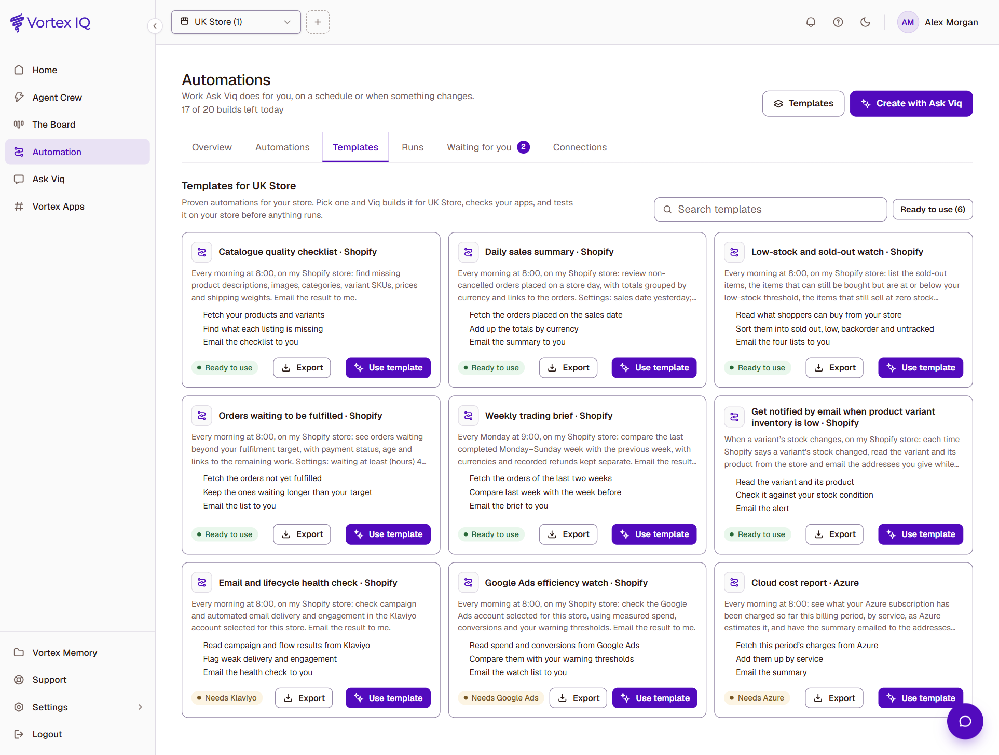
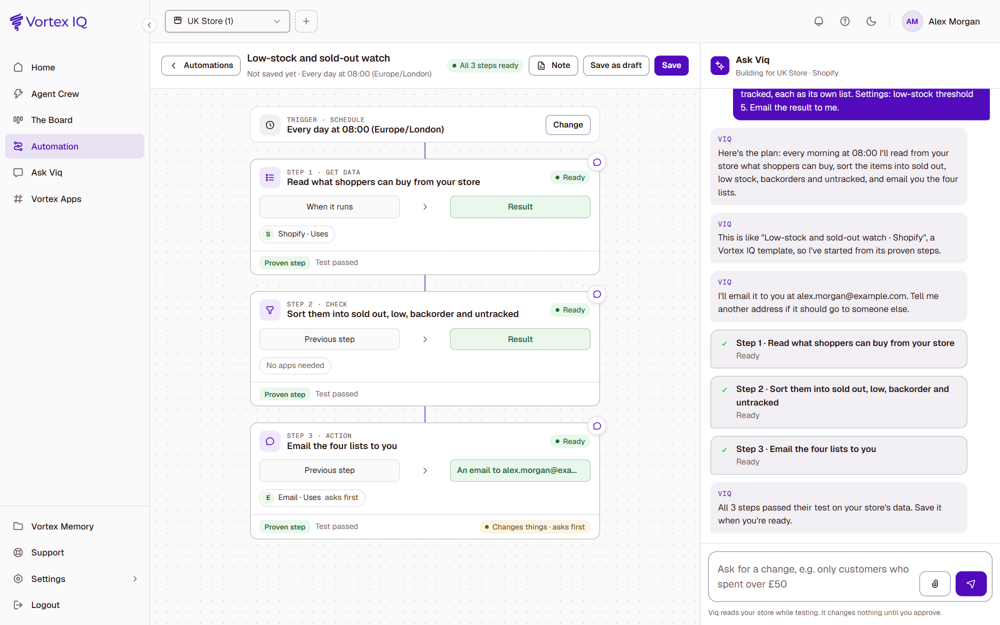

A template is an automation Vortex IQ has already designed and proven. You do not have to describe anything. Pick one, and Ask Viq builds it for your store and tests it on your own data.

## Open the templates

On the **Automations** page, select the **Templates** tab, or the **Templates** button at the top right.

<Frame>
  
</Frame>

The tab shows the templates for the store on the store profile you have selected. A Shopify store sees the Shopify templates, a BigCommerce store the BigCommerce ones, and an Adobe Commerce store the Adobe Commerce ones. Templates that do not depend on a store, such as cloud cost reports, are shown to everyone.

## Read a template card

| Part of the card | What it tells you |
| --- | --- |
| The title | What the template is for. |
| The sentence under it | The request Ask Viq will build, including when it runs and where the result goes. |
| The list | The steps the automation takes, in order. |
| **Ready to use** | Every app the template needs is connected on this store profile. |
| **Needs** and an app name | An app the template uses is not connected yet. You can still start it and connect the app on the way. |

To find a template:

- Type in **Search templates**. It searches titles, descriptions and app names.
- Select **Ready to use** to see only the templates you can use right away. Select it again to see all of them.

## Use a template

<Steps>
  <Step title="Select Use template">
    The builder opens with the template's request as your first message. Starting from a template counts as one build for the day.
  </Step>
  <Step title="Let Ask Viq build and test it">
    Ask Viq says it started from the template's proven steps, then builds each step and tests it on your store. This is the same build as in [Build with Ask Viq](/automations/build-with-ask-viq), only you did not have to write the request.
  </Step>
  <Step title="Connect an app if a step needs one">
    If the card said **Needs** an app, the build stops at that step and offers a button to connect it. Ask Viq carries on once the app is connected.
  </Step>
  <Step title="Make it yours">
    Ask for changes in the chat. For example: "Use a low-stock threshold of 10", "Send it at 7:30 instead" or "Email it to ops@example.com as well".
  </Step>
  <Step title="Save and approve">
    Select **Save**, choose when it runs, read what the automation can read and change, and select the approve button.
  </Step>
</Steps>

<Frame>
  
</Frame>

<Note>
  A template that emails a result sends it to your own email address, unless you name another one. Ask Viq tells you which address it will use, and you can change it in the chat.
</Note>

## What kinds of templates are there

The list changes as Vortex IQ adds templates. These are examples of what you can find.

| Area | Examples |
| --- | --- |
| Sales | Daily sales summary, Weekly trading brief, High-value order and VIP watch |
| Orders | Orders waiting to be fulfilled, Unpaid-order follow-up drafts, Order lookup and support reply draft |
| Stock | Low-stock and sold-out watch, Replenishment recommendations, Slow-moving and dead-stock review |
| Catalogue | Catalogue quality checklist, Price and margin exceptions, Find products shoppers cannot buy |
| Customers and marketing | Customer retention segments, Email and lifecycle health check, Google Ads efficiency watch |
| Storefront | Mobile storefront performance check |
| Cloud costs | Cloud cost reports for services such as Azure and Google Cloud |

## Export a template

Select **Export** on a card to download the template as a file. The file holds the template's name, when it runs, and each step with its settings. It holds no keys, no connections and no email addresses.

Whoever brings the file in connects their own apps, and its emails go to them. To bring a file in, attach it to a new chat in the builder. See [Bring in a workflow from a file or a picture](/automations/build-with-ask-viq#bring-in-a-workflow-from-a-file-or-a-picture).

## Good to know

- A template is a starting point. After you save, the automation is yours. Changing it does not change the template.
- If no template fits, describe what you need instead. See [Build with Ask Viq](/automations/build-with-ask-viq).
- If the tab says the templates could not be loaded, wait a moment and open the tab again.
