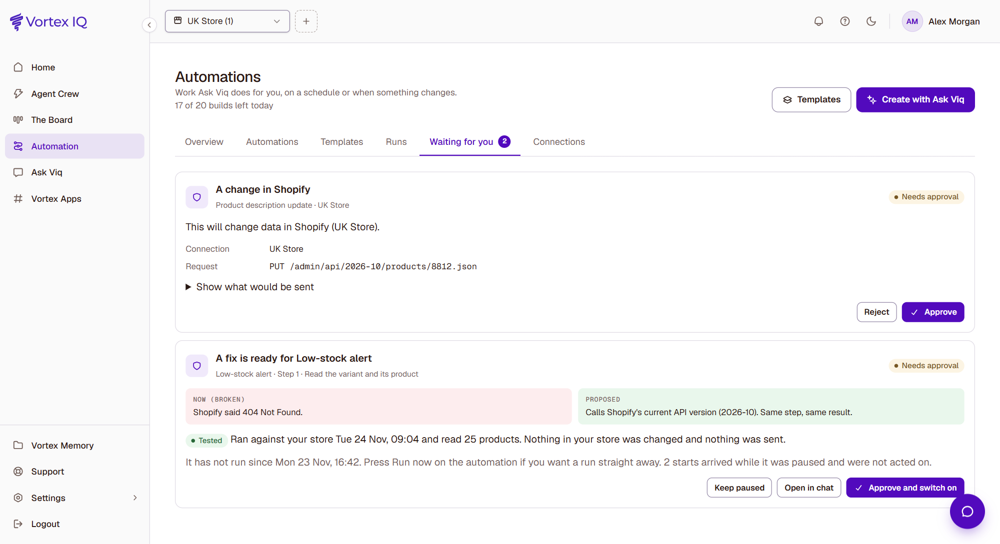

Nothing changes in your apps without your say. The **Waiting for you** tab collects everything that needs your decision.

<Frame>
  
</Frame>

You can tell that something is waiting from three places:

- The number on the **Waiting for you** tab.
- The **Waiting for you** tile on the **Overview** tab.
- The **Needs your attention** list on the **Overview** tab. Select **Review** to come here.

When nothing is waiting, the tab says "You're all caught up".

## Three moments when you approve

| When | What you approve | Where |
| --- | --- | --- |
| You save an automation | What that version can read and change, for every run. | The Save window. See [Save and approve](/automations/build-with-ask-viq#step-7-save-and-approve). |
| A single change is waiting | One change that Ask Viq, an agent or an automation wants to make in one of your apps, and that you have not approved yet. | A card on this tab. |
| An automation was paused and repaired | The repaired step, before the automation is switched on again. | A card on this tab. |

Because you approve an automation when you save it, its runs do not stop here each time. Only changes you have not approved yet wait on this tab.

## Approve or reject a change

A card titled "A change in" and the app's name is one change waiting to be made.

| On the card | What it tells you |
| --- | --- |
| The line under the title | What the change is for, and the connection it uses. |
| The sentence | Which app and store the change is for. |
| **Connection** | The connection the change goes through. |
| **Request** | The exact request that would be sent to the app. |
| **Show what would be sent** | Opens the full content of the change, so you can check it before you decide. |

Then choose:

- **Approve** sends the change, once. A message confirms that it was sent. If the app answers with an error, the message says so.
- **Reject** discards the change. Nothing is changed.

<Warning>
  A change waits for 15 minutes. After that the card shows **Expired**, its buttons go away and nothing is sent. If you still want the change, ask for it again.
</Warning>

## Review a fix for a paused automation

Apps change over time. When a step stops working because of such a change, Vortex IQ pauses the automation, so it does not keep failing, and tries to repair the step by itself. Vortex IQ also sends an email about the pause to the person who last saved the automation.

On the **Automations** tab, the automation shows **Paused · needs you**. Its card on this tab goes through these states:

| The card says | What is happening | What you can do |
| --- | --- | --- |
| **Preparing a fix** | Vortex IQ is rewriting the step and testing it against your store. Nothing runs meanwhile. | Wait. The card updates by itself. Or select **Remove automation** if you no longer need it. |
| **Needs approval**, titled "A fix is ready" | The repaired step passed its test. | Review it and decide. See below. |
| **Could not fix** | The repaired step did not pass its test. The automation stays paused. | Select **Open in chat** and ask Ask Viq to rebuild the step, or select **Remove automation**. |

### When a fix is ready

The card shows:

- **Now (broken):** what went wrong, such as the answer the app gave.
- **Proposed:** what the fix does. The step keeps doing the same job.
- **Tested:** how the fix was tested. The test read your store. Nothing in your store was changed and nothing was sent.
- How long the automation has been paused, and how many starts arrived meanwhile and were not acted on.

Then choose:

| Button | What it does |
| --- | --- |
| **Approve and switch on** | Saves the fix as a new version and switches the automation on from its next run. |
| **Keep paused** | Leaves the automation paused and closes the card. Nothing is changed. |
| **Open in chat** | Opens the automation so you can look at the steps or ask Ask Viq for something else. |

<Note>
  Approving a fix does not run the automation straight away. It runs at its next scheduled time or event. If you want a run at once, open the automation and select **Run now**.
</Note>

If the card says the failure could not be repeated in a test, the fix is not proven yet. The next run shows whether it works.

## Good to know

- Anyone who can open the page can approve a fix. Only the person who saved the automation can rebuild it by chat.
- Resuming a paused automation yourself, with **Resume** on the list, also closes its card.
- A failed run that has a fix waiting links here with **See it in Waiting for you**. See [Runs and results](/automations/runs-and-results).
