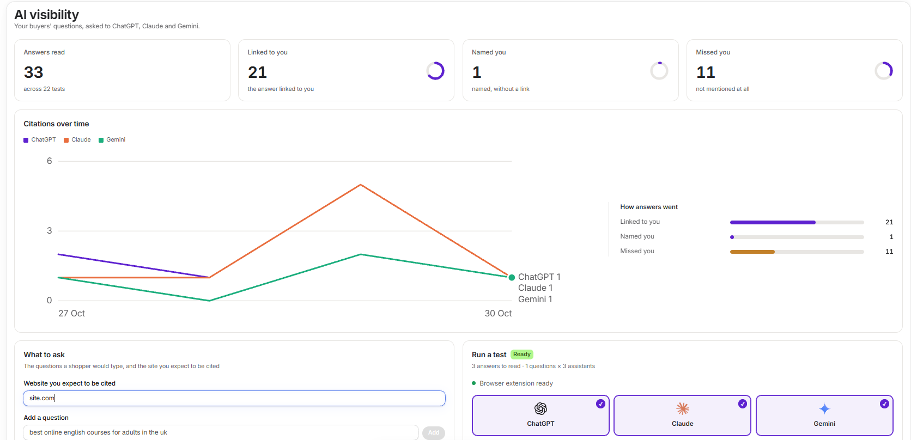

**AI visibility** asks ChatGPT, Claude and Gemini the questions your buyers ask, then shows whether each answer cited your store.

<Frame>
  
</Frame>

## Run a test

<Steps>
  <Step title="Add your website and questions">
    Under **What to ask**, enter the website you expect to be cited. Add questions the way a shopper would type them, without your store's name.
  </Step>
  <Step title="Choose assistants">
    Under **Run a test**, choose ChatGPT, Claude, Gemini or any mix.
  </Step>
  <Step title="Sign in to each assistant">
    Press **Run test**. The pop-up links to each assistant, so you can check you are signed in. Then press **I'm signed in. Run the test**.
  </Step>
  <Step title="Let it run">
    The questions are asked in your Chrome, so tabs open and switch while it works. Press **Stop** to end it after the question in progress.
  </Step>
</Steps>

<Note>
  An assistant you are not signed in to is skipped. The app never signs in for you.
</Note>

## Read the results

| Result | Meaning |
| --- | --- |
| **Linked to you** | The answer linked to your store |
| **Named you** | The answer named your store, without a link |
| **Missed you** | The answer did not mention you |
| **Skipped** | The question could not be asked, for example when you are not signed in |

**Where you never come up** lists questions across every test where you keep missing, and who came up instead. **Runs** lists each test, newest first. Open one to see its answers and the sites that came up.

## Keep your list tidy

Archive a run to remove it from the list and charts. Use **Show archived** to find it again, and **restore** to bring it back.

## Unfinished runs

If a run stops early, its page says how many questions were never asked. They are left out of the results, and you can resume the run.

## Article ideas

On Growth and Pro, the app reads each finished test for articles worth writing. They appear under **Content opportunities** on the run's page. Choose the ones you want, then press **Plan content for these**.
