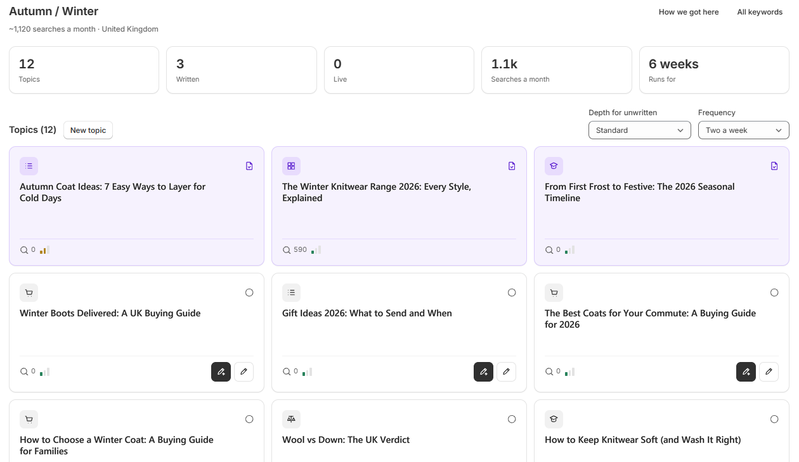

A content plan turns research on your market into a list of article topics. Nothing is written until you ask for it.

<Frame>
  
</Frame>

## Create a plan

<Steps>
  <Step title="The basics">
    Open **Content plans** and press **New content plan**. Enter a name, your website, your target market and any competitors.
  </Step>
  <Step title="What to write">
    Choose how many articles, what kinds, how long and how many a week. You can also add a focus, a brand voice and files to work from.
  </Step>
  <Step title="Check and go">
    Check that **Your Chrome** says **Connected**, then press **Generate topics**.
  </Step>
</Steps>

<Note>
  Research takes about 20 to 25 minutes. Keep Chrome open for about the first 18. It runs in the Chrome where you installed the extension, and you can stop it at any time.
</Note>

## Work with topics

Open a topic to see its keywords, related topics, products and links. For a topic that isn't written yet, **Settings and prompt** lets you change its type and length, drop it, and add instructions.

- **Write one:** use the write button on the topic card, or **Write this one** in the topic.
- **Add your own:** press **New topic** and enter a title.
- **See the research:** use **View research overview**, **How we got here** and **All keywords**.
- **Set the pace:** **Depth for unwritten** changes the length of unwritten topics, and **Frequency** changes how long the plan runs for.

Once a topic is written, its details are read-only. Make changes on the article's page in **Needs approval**.

## Article types

| Type | Good for |
| --- | --- |
| **Listicle** | Numbered picks |
| **Buying guide** | How to choose |
| **Product round-up** | Your products, grouped |
| **Opinion** | Your point of view |
| **Comparison** | A against B |
| **Explainer** | Teaching a concept |
| **Quick answer** | One question, answered directly |
| **Deep dive** | The definitive piece on a topic |

## Archive or delete a plan

Use the **...** menu on a plan. Deleting removes the plan, its topics and its drafts permanently. Articles already live in your store stay there.
