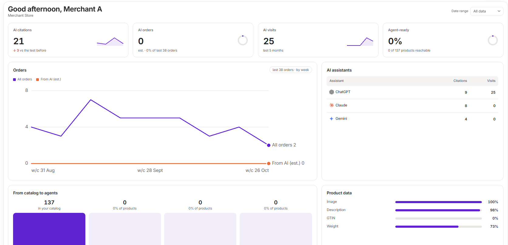

SEO, GEO and AI Visibility by Vortex IQ is a Shopify app that shows how ChatGPT, Claude and Gemini treat your store, then helps you act on it. It runs inside your Shopify admin.

<Frame>
  
</Frame>

## What you can do

<CardGroup cols={2}>
  <Card title="See your numbers" icon="chart-line" href="/vortex-apps/seo-geo-agent/overview-page">
    AI citations, AI orders, AI visits and how many products agents can reach.
  </Card>
  <Card title="Test AI assistants" icon="magnifying-glass" href="/vortex-apps/seo-geo-agent/ai-visibility">
    Ask the questions your buyers ask, and see who gets cited.
  </Card>
  <Card title="Plan and write content" icon="pen" href="/vortex-apps/seo-geo-agent/content-plans">
    Research topics, choose what to write, and review each article.
  </Card>
  <Card title="Publish to your store" icon="paper-plane" href="/vortex-apps/seo-geo-agent/publish">
    Publish, schedule or save a draft on your Shopify blog.
  </Card>
  <Card title="Fix your store" icon="wrench" href="/vortex-apps/seo-geo-agent/store-content">
    Check store health, edit content and compress product images.
  </Card>
  <Card title="Automate it" icon="bolt" href="/vortex-apps/seo-geo-agent/shopify-flow">
    Ask Sidekick about your AI visibility, or run actions from Shopify Flow.
  </Card>
</CardGroup>

## Where to start

<Steps>
  <Step title="Install the app">
    Follow [Install and get started](/vortex-apps/seo-geo-agent/getting-started).
  </Step>
  <Step title="Add the browser extension (optional)">
    AI visibility tests and content research run on our servers without it. Add the VortexIQ Chrome extension for more accurate results, from your own signed-in assistants.
  </Step>
  <Step title="Run your first test">
    Add a few buyer questions in [AI visibility](/vortex-apps/seo-geo-agent/ai-visibility), then press **Run test**.
  </Step>
</Steps>

## Get help

See [Troubleshooting and FAQs](/vortex-apps/seo-geo-agent/troubleshooting), or email support@vortexiq.ai.
