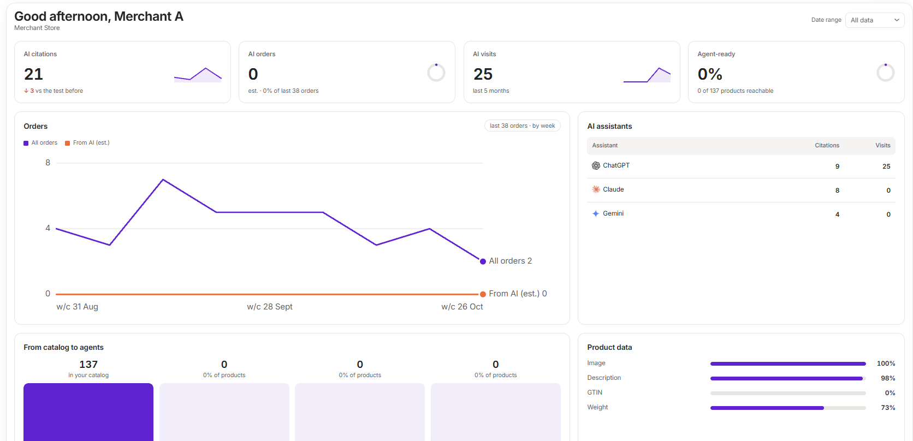

**Overview** is the app's home page. It shows how AI assistants affect your store, and what is stopping them.

<Frame>
  
</Frame>

## The date range

Use **Date range** at the top right to choose **All data**, **Last 7 days**, **Last 30 days** or **Last 60 days**. It changes citations, orders and Google Analytics figures. Cards about your catalog show today's state, so they don't change.

<Note>
  **All data** has limits. Orders cover the last 60 days and up to your latest 100 orders. Google Analytics covers the last 5 months.
</Note>

## The tiles

| Tile | What it shows |
| --- | --- |
| **AI citations** | How often answers linked to your store across your tests. Shows a dash and **Run a test** until you have run one. |
| **AI orders** | An estimate of orders from AI assistants, from what Shopify records about each order. |
| **AI visits** | Sessions from AI assistants. Shows **Connect** until Google Analytics is connected. |
| **Agent-ready** | The share of your products that are active and published to your online store. |

## The cards

- **Orders:** all orders against those estimated to be from AI.
- **AI assistants:** citations and visits for each assistant.
- **From catalog to agents:** how many products are in your catalog, reachable, passing every check and in feeds, with each as a share of your products.
- **Product data:** the share of products with an image and a description. GTIN and weight are measured against physical products only.
- **Where you stand:** a list of checks, with links to fix them in Shopify.

## AI referrals

Scroll down for **AI referrals**. It measures assistant traffic in two ways:

- **How orders arrived:** read from your Shopify orders. This needs nothing connected.
- **Who clicked through from an answer:** read from Google Analytics. This shows sessions, purchases, revenue, how that traffic compares with the rest of your store, and the pages assistants send shoppers to.

<Warning>
  AI orders are estimates. Shopify has no field that says an agent placed an order, so the app matches known assistant names across several order fields.
</Warning>
