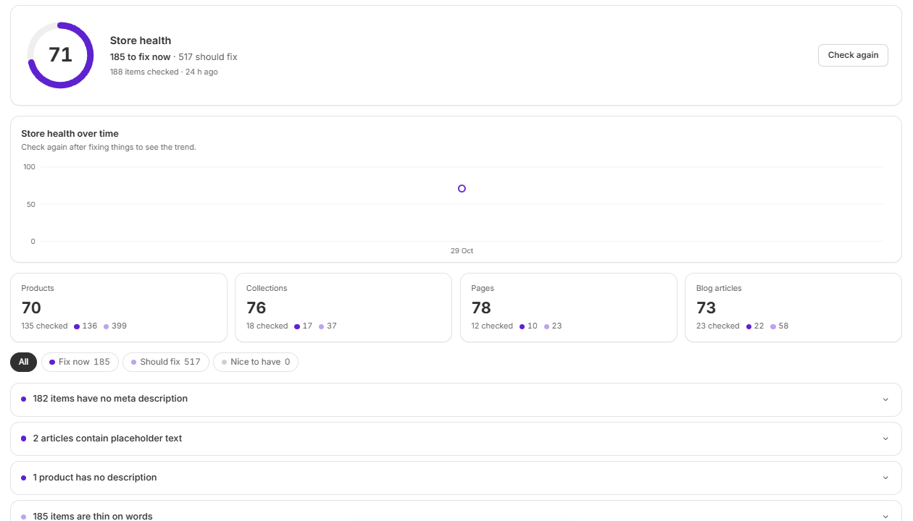
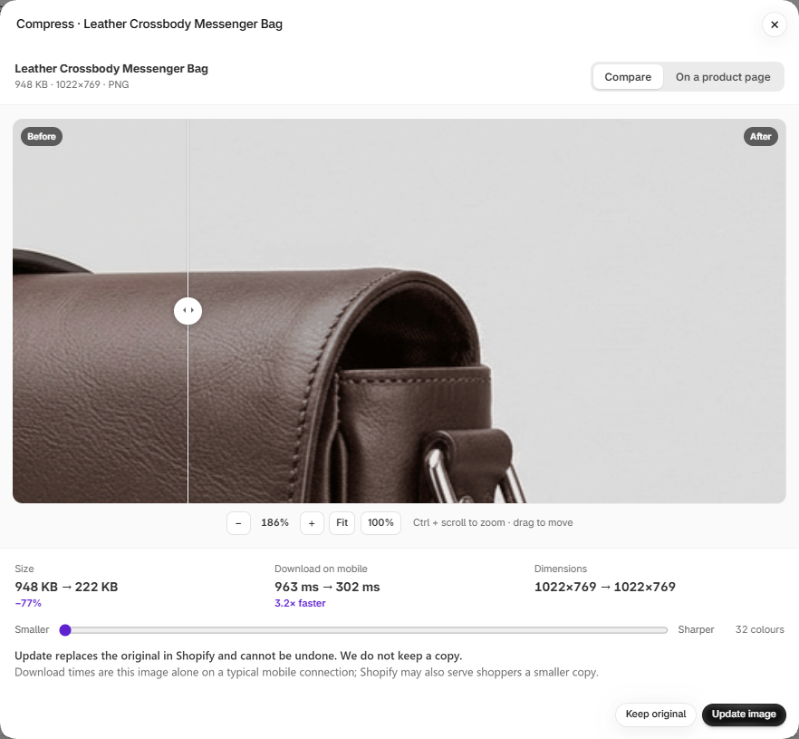

**Store content** works on what is already in your store. It has three tabs: **Content**, **Store health** and **Product images**. Press **Sync with the store** to refresh the app's copy.

## Content

Find a post, page, product or collection and open it to edit.

| Type | What you can change |
| --- | --- |
| **Posts and pages** | Title, body, address and SEO title and description |
| **Products** | Description and SEO fields. Never the name or price. |
| **Collections** | Title, description and SEO fields. Never the address. |

The editor's **History** keeps a copy before each change it writes, with **Undo** to put it back.

When a post's address changes, the app adds a redirect so old links keep working.

## Store health

<Frame>
  
</Frame>

Store health scores your products, collections, pages and blog articles, then lists what to fix. Issues are grouped as **Fix now**, **Should fix** and **Nice to have**. Examples include a missing meta description or thin content.

Open an issue to go to the item. On Pro, **Fix all** drafts fixes for you to check. Nothing is saved until you do.

The score updates after each check. A check run from Shopify Flow is marked **Refreshed from Flow**.

## Product images

**Check images** lists your images by weight, with their size and alt text.

<Frame>
  
</Frame>

Press **Compress** on Growth or Pro to open a preview. Compare before and after, see the size and speed saved, and move the slider to choose between smaller and sharper. **On a product page** shows the image in place.

<Warning>
  **Update image** replaces the original in Shopify and can't be undone. The app doesn't keep a copy. If you may want the original back, save it first.
</Warning>

The compressed image keeps its place on your products and its alt text. Images are re-saved in your browser, at most 2,048 pixels on the longest side.
